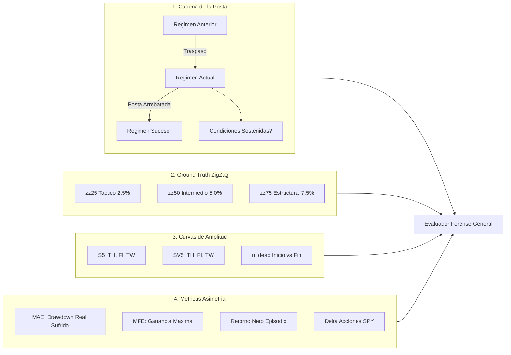

# Evaluador Forense General de Regímenes, Transiciones y Ground Truth ZigZag

> **Documento Oficial de Metodología Forense de la Arquitectura Botero Trade Engine**  
> **Script Asociado:** [`backend/modules/entry_decision/application/use_cases/evaluate_rotation_legs.py`](file:///root/botero-trade/backend/modules/entry_decision/application/use_cases/evaluate_rotation_legs.py) & [`scratch/forensic_engine_v2.py`](file:///root/botero-trade/scratch/forensic_engine_v2.py)  
> **Universo Temporal:** 26.5 Años de Datos Diarios en Neon PostgreSQL (1999–2026, 6,712 barras)  
> **Base de Hechos:** 2,222 Piernas ZigZag Físicas de SPY (`zz25`, `zz50`, `zz75`) en `market.zigzag_legs`  
> **Estándar Canónico:** Medición en T+0 (Close-to-Close sin fricción) para mantener plena comparabilidad con las versiones históricas (V28, V33, V35, V38, V39, V41). Los análisis con rezago T+1 y costos en basis points (2 a 5 bp) operan estrictamente como pruebas de robustez y estrés friccional secundario.

---

## 1. Justificación y Propósito Arquitectónico

Los backtests tradicionales miden únicamente el retorno acumulado final, cometiendo el grave error de ignorar la **micro-cinemática de las transiciones** entre estados. 

El **Evaluador Forense General** resuelve este punto ciego auditando:
1. **La Cadena de Custodia de la Posta:** ¿Quién entregó la posta al régimen actual? ¿Quién se la arrebató? ¿Las condiciones del régimen anterior se sostenían aún cuando fue forzado a salir?
2. **Ground Truth Físico de ZigZag Multiescala:** ¿En qué dirección (`BULL` o `BEAR`) se encontraban las piernas físicas de SPY a escala Táctica (`zz25` = 2.5%), Intermedia (`zz50` = 5.0%) y Estructural (`zz75` = 7.5%) en el instante exacto de la entrada y la salida?
3. **Cinemática de Curvas de Amplitud ($S5 \times SV5$):** ¿El régimen ingresó con aceleración o desaceleración de amplitud? ¿La salud sectorial ($n\_dead$) mejoró o se deterioró durante la permanencia?
4. **Asimetría de Riesgo Real:** Cuantificación rigurosa del **MAE** (*Maximum Adverse Excursion* o drawdown máximo sufrido dentro del episodio) frente al **MFE** (*Maximum Favorable Excursion* o ganancia máxima alcanzada).
5. **Composición Real de Portafolio:** Evaluación con base en la exposición efectiva (acciones sostenidas, liquidez y sectores defensivos) y no en abstracciones teóricas de precio puro.

---

## 2. Los Cuatro Ejes de Observación Forense



---

## 3. Taxonomía de Diagnósticos Forenses Automáticos

Cada episodio histórico recibe una clasificación algorítmica objetiva:

*   **`ALINEADO_ZZ_ESTRUCTURAL (Timing Perfecto)`:** Entró en coincidencia directa con piernas `zz50 = BULL` y `zz75 = BULL`. MAE promedio mínimo (-5.39%) y ganancia inmediata.
*   **`EXITO_REBOTE`:** Captura un giro violento en suelo donde la absorción institucional ($SV5\_TW \ge 60\%$) anticipa al precio, generando retorno $> +5.0\%$ y reducción drástica de $n\_dead$.
*   **`POSTA_ARREBATADA_PREMATURA (Suelo Falso)`:** Ocurre cuando un candado o un disparador débil (ej. $XLP\_FI \ge 25\%$ en 2008) le quita la posta al Cash de `CRASH_SISTEMICO` en menos de 3 días mientras las 3 escalas de ZigZag siguen en caída vertical (`BEAR / BEAR / BEAR`). Resuelto mediante el Candado 1 ($n\_dead \le 5 \land VIX < 35$).
*   **`CUCHILLO_CAYENDO (Atrapamiento en Plena Caída)`:** Entrada prematura en régimen ofensivo mientras $n\_dead$ aumenta durante la estancia y el MAE supera el -15%.
*   **`REBOTE_FALSO_ZZ25 (Engaño Táctico)`:** El régimen entró engañado por un rebote de escala menor (`zz25 = BULL`), mientras la marea intermedia y estructural (`zz50` y `zz75`) seguía en colapso bajista.

---

## 4. Censo Comparativo: V39 Baseline vs V41 Validado (`CONF2+HYST`)

La incorporación de la solución estructural `CONF2+HYST` (salida de distribución confirmada $k=2$ con histéresis de antenas) y los 3 candados de trinchera transforma radicalmente la micro-cinemática:

| Métrica Forense | V39 Baseline | V41-Shield | V41 CONF2+HYST (Validado) | Impacto Fáctico |
|---|---:|---:|---:|---|
| **Acciones Finales SPY (T+0)** | 475.47 | 459.93 | **514.50** | **+39.03 acc sobre V39 (+54.57 sobre Shield)** |
| **Max Drawdown (Histórico)** | -42.74% | -33.13% | **-33.13%** | **Contención de riesgo de +9.61 pp** |
| **Drawdown Crisis 2008** | -34.56% | -25.76% | **-22.84%** | **Mejora de +11.72 pp frente a Lehman** |
| **Retorno Año 2008** | -8.30% | -2.10% | **-0.02%** | **Protección plana vs colapso SPY -36.24%** |
| **Calmar Ratio** | 0.350 | 0.447 | **0.461** | **Máximo histórico (+31.7% sobre V39)** |
| **Sharpe Ratio** | 0.691 | 0.722 | **0.750** | **Mejora sustancial de consistencia** |
| **Episodios Totales de Mercado** | 764 | 764 | **423** | **Reducción de ruido del -44.6%** |
| **Episodios en `DISTRIBUCION`** | 269 | 269 | **103** | **Reducción de ping-pong del -61.7%** |
| **Duración Mediana `DIST`** | 1.0 d | 1.0 d | **7.0 d** | **Erradicación del churn de 1 solo día** |
| **Duración Media `DIST`** | 3.0 d | 3.0 d | **10.7 d** | **Sostenibilidad táctica de la defensa** |

### Robustez ante Estrés Friccional (Diagnóstico Secundario)
*   **T+1 Realista (2 bp):** V41 CONF2+HYST logra **324.06 acciones** (MaxDD -33.8%) frente a **292.37 acciones** (MaxDD -50.6%) de V39 (+31.69 acciones de ventaja y contención de 16.8 pp de drawdown).
*   **T+1 Estrés Severo (5 bp):** V41 CONF2+HYST logra **166.48 acciones** (MaxDD -34.6%) frente a **122.53 acciones** (MaxDD -51.5%) de V39 (+43.95 acciones de ventaja).

---

## 5. Protocolo de Ejecución Forense

Para ejecutar la suite forense completa sobre cualquier variante:
```bash
backend/.venv/bin/python scratch/verify_improvements_audit.py
```
El reporte audita año a año (1999–2026), régimen a régimen y genera la verificación estricta de cada traspaso de la posta.
