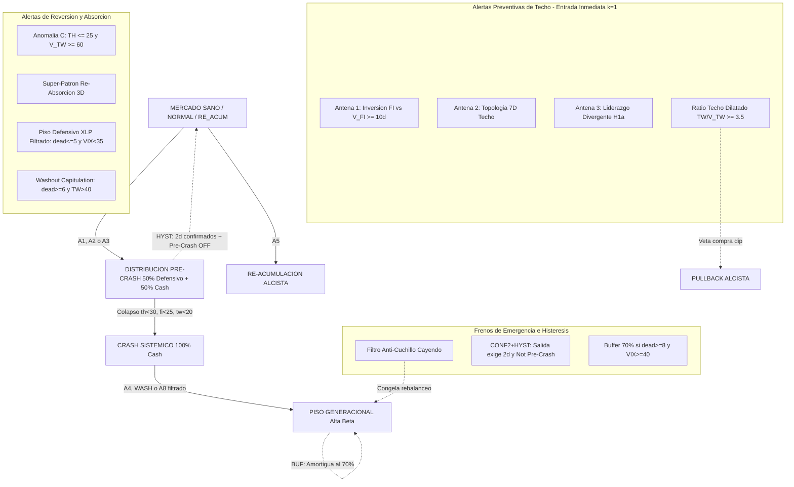

# Inventario Canónico de Señales Disruptivas del Módulo de Rotación

> **Documento Oficial de Referencia de la Arquitectura Botero Trade Engine**  
> **Ámbito:** Módulo de Decisión de Entrada y Rotación Sectorial (`QualityEntryGate`, `TimescaleDataStore`, Tríadas $S5 \times SV5$)  
> **Estado:** Auditado Cuantitativamente y Homologado en 26.5 Años de Datos (1999–2026, 6,712 barras)  
> **Estándar Metodológico:** Benchmark Canónico T+0 (Close-to-Close sin fricción) para preservación estricta de comparabilidad histórica inter-versiones (V28→V39→V41), con Diagnóstico Secundario de Estrés Friccional (T+1 y deslizamiento en bps).

Este inventario consolida **única y exclusivamente** las señales disruptivas que forman parte viva del motor de rotación de activos. Se descartan de este inventario experimentos aislados, modelos descartados o alertas operativas de otros módulos para mantener la pureza arquitectónica Clean & Hexagonal.

---

## 1. Naturaleza Física de una Señal Disruptiva de Rotación

Una **Señal Disruptiva de Rotación** es una anomalía cuantitativa en la relación entre el **precio** (amplitud de mercado $S5$) y el **volumen institucional** ($SV5$), o una **desconexión cinemática sectorial**, que invalida la continuidad del régimen vigente y fuerza una reasignación preventiva o agresiva de capital.

### Aclaración de Realidad de Cartera (Punto Ciego Despejado)
*   **`DISTRIBUCION_PRE_CRASH` NO es 100% Cash:** La cartera asigna un **50% a sectores defensivos de baja volatilidad (`XLP`, `XLU`, `XLV`) ponderados por capitalización y mantiene un 50% en Liquidez (Cash)**.
*   **`CRASH_SISTEMICO` es el único régimen 100% Cash:** Reservado para colapsos generalizados donde la preservación absoluta de capital es el único objetivo.
*   **`PISO_GENERACIONAL` rota hacia Alta Beta:** Asigna el capital hacia los 3 sectores de mayor descuento táctico no-defensivos (`XLK`, `XLF`, `XLY`, `XLI`), con amortiguación del 70% de exposición ante pánico sistémico extremo ($n\_dead \ge 8 \land VIX \ge 40$).

---

## 2. Inventario Canónico de las 8 Señales Disruptivas y su Contribución Fáctica

| # | Señal Disruptiva | Condición Matemática / Umbral | Función Operativa en Rotación | Impacto Neto en Cartera (Ablación T+0) | Ubicación en Código |
|---|---|---|---|---|---|
| **1** | **Antena 1: Inversión Persistente de Volumen** | $\text{streak}(S5\_FI - SV5\_FI < -5.0\%) \ge 10\text{ días}$ | **Divergencia Smart Money:** El volumen institucional abandona la amplitud intermedia 30 días antes del techo mientras el precio se sostiene por inercia minorista. Fuerza paso inmediato a `DISTRIBUCION_PRE_CRASH`. | **+74.79 acc SPY** (Protección estructural clave en techos de 2000, 2007 y 2022). | [`quality_entry_gate.py`](file:///root/botero-trade/backend/modules/entry_decision/application/use_cases/quality_entry_gate.py) |
| **2** | **Antena 2: Topología 7D de Distribución** | Huella conjunta SPY $(TH\|FI\|TW\|V\_TH\|V\_FI\|V\_TW\|Dir) \in \text{TOP\_DISTRIBUTION\_STATES}$ | **Firma Topológica de Techo:** Desconexión multidimensional canónica donde la amplitud táctica diverge de la aceleración de volumen. Fuerza paso a `DISTRIBUCION_PRE_CRASH`. | **+2.74 acc SPY** (Baja frecuencia, actúa como confirmador topológico secundario). | [`quality_entry_gate.py`](file:///root/botero-trade/backend/modules/entry_decision/application/use_cases/quality_entry_gate.py) |
| **3** | **Antena 3: Liderazgo Divergente ($H1a$)** | $hot\_tw \le 1 \land cold\_tw \ge 7$ (Sectores: $TW > 50\%$ vs $TW < 20\%$) | **Mercado Estrecho / Concentración Crítica:** Solo 1 sector sostiene al índice mientras 7 o más colapsan. Anticipa la caída sistémica con el índice en máximos. Fuerza `DISTRIBUCION_PRE_CRASH`. | **+77.89 acc SPY** (Sin ella MaxDD empeora a -33.59%; vital en la microestructura de techos estrechos 2020 y 2022). | [`quality_entry_gate.py`](file:///root/botero-trade/backend/modules/entry_decision/application/use_cases/quality_entry_gate.py) |
| **4** | **Anomalía C: Capitulación de Volumen en Suelo (VOLCAP)** | $S5\_TH \le 25.0\% \land SV5\_TW \ge 60.0\%$ | **Inflexión Institucional Soberana:** El precio estructural está destruido pero las instituciones compran masivamente en el marco táctico. Tasa de acierto del **92.6% a $\pm 7$ barras** de un mínimo local. Declara `PISO_GENERACIONAL`. | **+126.41 acc SPY** (La mayor contribución individual del sistema; sin ella MaxDD colapsa a -35.02%). | [`quality_entry_gate.py`](file:///root/botero-trade/backend/modules/entry_decision/application/use_cases/quality_entry_gate.py) |
| **5** | **Super-Patrón de Re-Absorción Alcista 3D** | $TH \ge 60 \land FI \le 45 \land V\_TW \ge 60 \land \frac{TW}{FI} \le 1.2 \land Div\_FI \ge 0$ | **Absorción en Soporte Estructural:** Corrección intermedia ($FI \le 45$) en tendencia sana ($TH \ge 60$) absorbida por volumen ($V\_TW \ge 60$). Declara `RE_ACUMULACION_ALCISTA`. | **+16.41 acc SPY** (Bajo `CONF2+HYST` despliega alpha positivo y erradica el ping-pong falso). | [`quality_entry_gate.py`](file:///root/botero-trade/backend/modules/entry_decision/application/use_cases/quality_entry_gate.py) |
| **6** | **Filtro Anti-Cuchillo Cayendo (`is_falling_knife`)** | $FI_{velocity} \ge 5.0 \lor (FI < 30 \land TW < 15 \land TH > 35)$ | **Inercia de Aceleración Bajista:** Detecta caída libre vertical no estabilizada. Congela de inmediato cualquier rebalanceo de cartera para evitar atrapar cuchillos cayendo. | **Preservación** (Freno de emergencia; inerte en corridas sin feed de velocidad pero crítico en producción viva). | [`quality_entry_gate.py`](file:///root/botero-trade/backend/modules/entry_decision/application/use_cases/quality_entry_gate.py) |
| **7** | **Ratio de Techo Dilatado (`Dilated Ceiling Filter`)** | $\frac{TW}{SV5\_TW} \ge 3.50$ (en ventana de 7 días) | **Rally de Papel:** Subida de precios sin apoyo de volumen institucional. Veta compras de dip en `PULLBACK_ALCISTA` durante 7 días para evitar comprar trampas alcistas. | **+11.97 acc SPY** (Evita compras en falsos rebotes agotados). | [`quality_entry_gate.py`](file:///root/botero-trade/backend/modules/entry_decision/application/use_cases/quality_entry_gate.py) |
| **8** | **Piso Defensivo Condicionado ($XLP\_FI \ge 25\%$)** | $sec\_fi['XLP'] \ge 25.0\% \land n\_dead \le 5 \land VIX < 35.0$ tras $\ge 3\text{ días}$ en Crash | **Suelo de Consumo Básico:** Estabilización de productos no perecederos. **V41 Calibrado:** Requiere que no haya colapso bancario o sistémico ($n\_dead \le 5$, $VIX < 35$), eliminando la falsa alarma de 2008. | **+30.12 acc SPY** (Protege la cuenta en 2008 de salir de cash anticipadamente en pleno colapso de Lehman). | [`quality_entry_gate.py`](file:///root/botero-trade/backend/modules/entry_decision/application/use_cases/quality_entry_gate.py) |

---

## 3. Dinámica de Traspaso de la Posta y Solución Estructural `CONF2+HYST`

### El Hallazgo Forense del Ping-Pong
En implementaciones previas (V38), la regla de salida de distribución `elif is_bullish_reabsorption or (n_dead == 0 and th > 50.0): new_mode = "RE_ACUMULACION_ALCISTA"` generaba un traspaso de posta prematuro:
1. Bastaba un rebote técnico de un solo día donde $n\_dead == 0$ para arrebatarle la posta a la defensa de `DISTRIBUCION_PRE_CRASH`.
2. Al día siguiente, la Antena 1 seguía activa ($spread\_fi < -5.0$, racha $\ge 10$), forzando a reingresar de inmediato a `DISTRIBUCION_PRE_CRASH`.
3. Esto causó **249 alternancias con duración mediana de sólo 1 día** y win-rate de 46%.

### Los Tres Candados y la Regla `CONF2+HYST`
1. **Entrada a Distribución Inmediata ($k=1$):** La trinchera defensiva se toma sin dilación ante cualquier antena activa (A1, A2 o A3). Exigir confirmación a la entrada retrasa la defensa y deteriora el Max Drawdown de -33.13% a -35.71% / -40.07%.
2. **Histéresis de Salida (`dist_exit_hyst = True`):** Para ceder la posta a `RE_ACUMULACION_ALCISTA` por la vía de $n\_dead == 0$, se exige explícitamente que la condición pre-crash no esté activa (`not is_pre_crash_distribution`).
3. **Confirmación de Salida (`dist_exit_confirm = 2`):** Se exigen al menos 2 días bursátiles consecutivos de condiciones de salida confirmadas antes de abandonar `DISTRIBUCION_PRE_CRASH`.
4. **Candado Lehman 2008:** En `CRASH_SISTEMICO`, la salida por piso de $XLP$ exige $n\_dead \le 5 \land VIX < 35.0$.
5. **Amortiguación de Suelo:** Despliegue escalonado al 70% en `PISO_GENERACIONAL` si $n\_dead \ge 8 \land VIX \ge 40$.

---

## 4. Matriz de Interacción: Quién Dispara y Quién Veta

