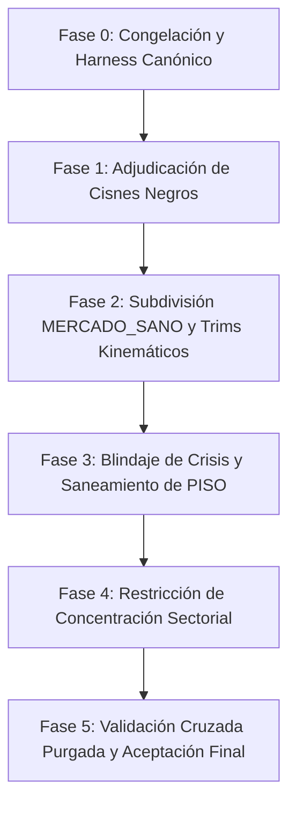

# GUÍAS / PROMPT — ELIMINAR EL DRAWDOWN PROFUNDO DEL MÓDULO DE ROTACIÓN

**Fecha:** 21-Oct-2026 (Revisión Auditada y Perfeccionada v2.0)  
**Objetivo:** Que el portafolio de rotación **no sufra ninguna caída superior a una corrección simple (< 20%)**, salvo cisne negro demostrado bajo criterios institucionales estrictos.  
**Autoridad:** Se autoriza explícitamente **ciencia de datos, machine learning, deep learning, análisis estadístico y modelado de regímenes** para resolverlo.  
**Nota de Autocontención:** Este documento es **100% autocontenido y auditable**. Cada métrica, evento y regla describe su causa raíz mecánica en código y su método exacto de reproducción.

---

## 0. PRINCIPIO RECTOR Y DEFINICIÓN DEL ÉXITO

**Un drawdown superior a una corrección simple (≥ 20%) es inaceptable, salvo cisne negro demostrado.**  
Caer −30% obliga a ganar +43% sólo para recuperar el capital original; caer −42% obliga a ganar +72%. Eso no es gestión de riesgo: es ceguera operativa y persistencia en regímenes caducos.  
El sistema cuenta con excelentes señales de entrada y captura de tendencia; **el defecto reside exclusivamente en la salida oportuna, la persistencia inercial en regímenes agotados y la asignación agresiva en falsos suelos.**

### 0.1 Definición operativa (Taxonomía del Evaluador Forense)

El evaluador canónico (`backend/modules/entry_decision/application/use_cases/evaluate_rotation_legs.py`) clasifica las caídas de cartera por magnitud y cinética:

```
1. PULLBACK                    (< 10%)                         -> ACEPTABLE (Ruido / volatilidad normal)
2. CORRECCION                  (10% a 20%)                     -> ACEPTABLE (Ajuste cíclico estándar)
3. BEAR_MARKET_GRADUAL         (>= 20%, velocidad < 0,35%/d)   -> INACEPTABLE (Inercia y fallo de salida)
4. CRASH_FINANCIERO_ABRUPTO    (>= 20%, velocidad >= 0,35%/d)  -> INACEPTABLE salvo cisne negro demostrado
```

**⇒ CRITERIO SUPREMO DE ÉXITO:**  
**CERO eventos en los niveles 3 y 4 (Drawdown de cartera < −20,0%) a lo largo de toda la historia 1999–2026, con la única excepción de aquellos que cumplan rigurosamente las 3 condiciones de cisne negro.**

### 0.2 Las Tres Condiciones Obligatorias de Cisne Negro (No Negociables)

Un evento se exime de la restricción de caída (< 20%) **ÚNICAMENTE si cumple simultáneamente las TRES condiciones**:

1. **SPY cayó MÁS que la cartera en la misma ventana:** El sistema protegió y contuvo la caída; no amplificó el daño (`dd_cartera > dd_spy_ventana`).
2. **Severidad estadística extrema del índice:** La caída de SPY en esa ventana supera un umbral que en los 26,7 años de historia ocurrió **3 veces o menos** (históricamente en SPY sólo existen 4 caídas ≥ 20%: Dotcom −47,5%, GFC −55,2%, COVID −33,7%, Inflación 2022 −24,5%).
3. **Disparador exógeno no recurrente:** El origen fue un colapso exógeno no modelable endógenamente (congelamiento crediticio sistémico global, pandemia con cierre forzoso, ataque terrorista con cierre de mercados) y **NO** una rotación cíclica o sobrecompra prolongada de mercado.

> [!CAUTION]
> **Si falla CUALQUIERA de las tres condiciones, el evento es un DEFECTO ESTRUCTURAL DEL SISTEMA y debe ser eliminado por el modelo.**

---

## 1. ESTADO VERIFICADO Y AUDITORÍA DE DATOS (Línea Base Canónica)

- **Entorno de Simulación:** Canónico **T+0** (Close-to-Close, la decisión tomada al cierre de la barra $t$ rige el retorno de la barra $t+1$).
- **Muestra Temporal:** 15-Dic-1999 → Oct-2026 (**6.714 barras de trading**).
- **Rendimiento Canónico (CONGELADO 21-Oct):** **584,52 acciones SPY equivalentes** con **Max Drawdown −34,93%** (GFC 2007–2009), ventana 1999-12-15 → **2026-10-20 cierre**. ⚠️ La cifra previa «585,00» se calculó con la barra 2026-10-20 aún intradía (única barra que difiere; 0 diferencias de modo en 6.714 barras). Harness: `scratch/dd_guidance_harness.py` (variante `B0`).
- **Fuentes de Datos:** `scratch/eval_v2_out/portfolio_drawdowns_gt5.csv`, `regime_episodes.csv` y `dd_vs_confirmation.csv`.

### 1.1 Hechos Medidos y Reproducibles (Censo Completo de las 47 Caídas > 5%)

```
Total caídas de cartera > 5% en 26,7 años     :  47
  Nivel 1: PULLBACK      (< 10%)              :  30
  Nivel 2: CORRECCION    (10% a 20%)          :  12
  Nivel 3: BEAR moderado (20% a 30%)          :   3  <- INACEPTABLE (Objetivo de erradicación)
  Nivel 4: BEAR profundo (> 30%)              :   2  <- INACEPTABLE (Objetivo de erradicación)

Caídas MÁS PROFUNDAS que SPY en la ventana    :  25 / 47 (53,2% de los eventos amplificaron la pérdida)
Cash medio mantenido durante las 47 caídas    :  0,006%  (El sistema permanece 99,99% invertido)
Intervención de CRASH_SISTEMICO en caídas     :   5 / 47 caídas (Suma 52 barras en 26,7 años = 0,77% del tiempo)
Retorno de CRASH_SISTEMICO durante crisis     :   0,00 log-pp (Propiedad matemática del 100% Cash: funciona bien, pero no llega a tiempo)
```

**Descomposición de Pérdidas Agregadas por Modo en las 47 Caídas:**

| Modo Operativo | Pérdida Aportada (log-pp) | Nº Eventos donde fue el Peor Modo | Beta vs SPY | Causa Mecánica Principal |
|---|---:|---:|---:|---|
| **MERCADO_SANO** | **−312,4** | **29 / 47** | 0,93 | Inercia en zona muerta de amplitud (30%–60%) sin trims tácticos. |
| **PISO_GENERACIONAL** | **−108,7** | **6 / 47** | 1,08 | Asignación agresiva 100% long en XLF (59%–67%) atrapando cuchillos. |
| **DISTRIBUCION_PRE_CRASH** | **−67,1** | **4 / 47** | 0,64 | 100% invertido en defensivos (XLV/XLP/XLU); no posee liquidez ni cash. |
| **RE_ACUMULACION_ALCISTA** | **−32,9** | **4 / 47** | 1,10 | Entradas prematuras en rebotes falsos dentro de piernas bajistas. |
| **NORMAL** | **−23,4** | **2 / 47** | 1,06 | Asignación concentrada en QQQ (hasta 80%) al inicio de giros bajistas. |
| **RECUPERACION** | **−6,2** | **1 / 47** | 1,19 | Beta alta en rebotes que fallan y hacen nuevos mínimos. |
| **PULLBACK_ALCISTA** | **+1,4** | **1 / 47** | 1,00 | Modo de absorción de caídas menores; aporta retorno neto levemente positivo. |
| **CRASH_SISTEMICO** | **0,0** | **0 / 47** | 0,00 | 100% Cash. Funciona perfecto cuando está activo; el fallo es su latencia. |
| **TOTAL** | **−549,3** | **47** | — | **MERCADO_SANO + PISO explican el 76,6% de todas las pérdidas en caídas.** |

---

### 1.2 Auditoría Forense de los 5 Eventos Inaceptables (≥ 20%)

Estos son los 5 episodios históricos que determinan el éxito del proyecto:

| # | Ventana (Pico → Valle) | Cartera | SPY Ventana | Barras | Modo que Más Perdió | Contribución | ¿Cisne Negro Demostrado? | Dictamen Institucional |
|---|---|---:|---:|---:|---|---:|:---:|---|
| **1** | 2007-10-09 → 2009-03-06 (GFC) | **−34,93%** | −54,74% | 354 | PISO_GENERACIONAL | −25,1 log-pp | **SI (Contexto)**, pero con defecto interno | SPY cayó −54,7% (Cond 1 y 2 cumplidas). CRASH duró 5 barras (09-29→10-06) y PISO entró con XLK 72% / XLY 23% en plena quiebra de Lehman; tras un segundo CRASH de 3 barras, PISO volvió con XLF 59% (2008-12-22). |
| **2** | 2001-12-06 → 2002-07-23 (Dotcom 2) | **−33,19%** | −31,69% | 156 | MERCADO_SANO | −22,6 log-pp | **NO (DEFECTO PURO)** | **Falla Condición 1:** La cartera cayó MÁS que SPY (−33,2% vs −31,7%). El sistema permaneció 100% invertido durante 109 barras en MERCADO_SANO sin reconocer el mercado bajista secular. |
| **3** | 2020-02-19 → 2020-03-23 (COVID) | **−25,70%** | −33,72% | 23 | PISO_GENERACIONAL | −16,1 log-pp | **SÍ (Contexto)**, pero con fallo de oportunidad | SPY cayó −33,7% en 23 barras por shock exógeno (Cond 1, 2 y 3 cumplidas). No obstante, CRASH sólo duró 2 barras y el sistema saltó de inmediato a PISO_GENERACIONAL perdiendo −16,1 log-pp en la segunda pata. |
| **4** | 2001-05-21 → 2001-09-21 (Dotcom / 9-11) | **−21,26%** | −25,62% | 82 | MERCADO_SANO | −22,4 log-pp | **SÍ (Contexto)**, amortiguó parcialmente | SPY cayó −25,6% culminando en el shock del 11 de Septiembre (cierre de bolsas). La cartera contuvo a −21,3%, pero MERCADO_SANO absorbió casi toda la pérdida por falta de trims tácticos. |
| **5** | 2011-05-10 → 2011-08-19 (US Downgrade) | **−20,42%** | −17,07% | 71 | MERCADO_SANO | −11,5 log-pp | **NO (DEFECTO PURO)** | **Falla Condición 1:** La cartera cayó MÁS que el índice (−20,4% vs −17,1%). Pérdida amplificada por inercia en MERCADO_SANO y entrada prematura en PISO (−9,0 log-pp). |

---

### 1.3 Lo que la Evidencia Empírica ya Descartó (Prohibido Re-proponerlo)

1. **Modificadores estáticos de Sizing:** La auditoría empírica de la propuesta V41 demostró que cortar el tamaño en regímenes fijos destruye el alpha (+40,64 acciones prometidas vs −51,03 acciones reales obtenidas). Reducir exposición arbitrariamente en recuperaciones también corta las subidas explosivas.
2. **Candados basados en días calendario:** El mercado opera por regímenes y cinemáticas de volumen/amplitud, no por días de reloj. Todo temporizador basado en `days_in_mode` es un artificio arbitrario que retrasa la defensa o la salida.
3. **Optimización In-Sample:** Ajustar umbrales a posteriori para esquivar los 5 eventos específicos genera sobreajuste severo. Todo modelo debe validarse mediante Purged Cross-Validation (CPCV) por ciclos.

---

## 2. DIAGNÓSTICO MECÁNICO EN CÓDIGO DE LAS CINCO CAUSAS RAÍZ

Para que el ejecutor no pierda tiempo investigando hipótesis a ciegas, aquí se detallan las **líneas de código exactas** de `backend/modules/entry_decision/application/use_cases/quality_entry_gate.py` que generan mecánicamente los drawdowns:

### P1 — Latencia Estructural e Intercepción de `CRASH_SISTEMICO` (Líneas 224, 253, 336-342)
- **Causa 1 (Umbral triple retardado):** Para pasar de `MERCADO_SANO` o `DISTRIBUCION` a `CRASH_SISTEMICO`, el código exige: `th < 30.0 and fi < 25.0 and tw < 20.0 and n_dead >= 5`.
  *Mecánica:* Como S5TH es una media móvil de 200 días y S5FI de 50 días, para cuando el 70% de las acciones caen bajo su media de 200 días y 5 sectores mueren, el SPY ya ha caído entre −15% y −25%.
- **Causa 2 (Intercepción V36 Redirection, L336-342):** Si el sistema finalmente detecta el colapso, el bloque V36 ejecuta:
  ```python
  if current_mode != "CRASH_SISTEMICO" and new_mode == "CRASH_SISTEMICO" and v_th >= 25.0:
      if vix <= 28.0:
          new_mode = "PISO_GENERACIONAL"
  ```
  Esto **intercepta el refugio en Cash y redirige a comprar agresivamente**, creyendo erróneamente que es un suelo.

### P2 — Salida prematura de `CRASH_SISTEMICO` y concentración de `PISO_GENERACIONAL` (L281-285, L441-457)
- **Causa Mecánica verificada:** desde CRASH, `is_volume_capitulation` (th≤25 y v_tw≥60) lleva a PISO **sin** exigir `can_switch_crash`. CRASH duró 2 barras en 2020 (03-09→03-11), 5 en 2008-09, 2 en 2002-07 y **1 en 2011-08**. Total CRASH en 26,7 años: 55 barras.
- PISO asigna 100% a los **3 sectores no defensivos con menor S5_TW**, ponderados por cap. Observado: XLK 72% (2008-10), XLK 60% (2020-03), XLF 59% (2008-12), XLF 48% (2002-07), XLI 56% (2011-08). El Candado 2 (`scale=0.70`, L451) es inerte por la renormalización de L597-599.

### P3 y P5 — `MERCADO_SANO`: Contenedor Inercial y Zona Muerta de Amplitud (Líneas 223-251)
- **Causa Mecánica (Asimetría de Histéresis):**
  - Para entrar a `MERCADO_SANO`: requiere `th > 60.0 and fi > 50.0 and tw > 40.0`.
  - Para salir hacia Cash (`CRASH`): requiere `th < 30.0 and fi < 25.0 and tw < 20.0`.
- **La Zona Muerta (30% a 60%):** Cuando la amplitud estructural se deteriora de 60% a 35%, el mercado cae violentamente, pero como no cumple la condición extrema de colapso, **el sistema permanece inmóvil en `MERCADO_SANO` durante semanas**, absorbiendo −312,4 log-pp en 29 eventos distintos.
- **Falta de Graduación Kinemática:** `MERCADO_SANO` representa el 63,5% del tiempo (4.262 barras) con 47,5% de episodios con retorno negativo. No posee estados intermedios de recorte (`MKT_TRIM_TACTICAL`) basados en la velocidad de deterioro ($\Delta 3d$ METAR D2) ni en volumen SV5.

### P4 — Concentración Sectorial (L515-599)
- **Causa Mecánica en `calculate_target_weights`:** en NORMAL/MERCADO_SANO el core se pondera por cap y XLK se sustituye por QQQ (L592-595); con pocos sectores sanos QQQ llega a 80% (2000-01-03). No existe techo por posición.
- ⚠️ **Medido 21-Oct:** un techo de 35% **empeora** el resultado (ver §8). La concentración amplifica episodios puntuales, pero no es la causa de los 5 eventos ≥20%.

---

## 3. EL PARADIGMA: ANTICIPACIÓN vs ESTADO Y CASCADA DE ESCALAS

### 3.1 La Medición de Anticipación vs Acción (Datos Auditados)
Al evaluar el ciclo multiescala de giro de mercado:
- **La Defensa en `zz100`:** El 74,8% de las acciones defensivas ocurren en `PRE_PIVOTE` (mediana 158 barras antes de confirmar el techo), con un valor mediano de −6,7 log-pp (se sale excesivamente temprano por ruido de indicadores planos).
- **La Ofensiva en `zz100`:** El 69,4% de las entradas ocurren en `POST_CONFIRMACION` (mediana 162 barras tarde tras el suelo).
- **Costo de salir a ciegas en cada confirmación técnica:**
  - Salir en cada techo `zz25` y reentrar en el suelo cuesta **−158,9 log-pp** (acierto base 0,32).
  - Salir en cada techo `zz50` cuesta **−192,4 log-pp** (acierto base 0,19).
  - **Salir en cada oscilación menor DESTRUYE VALOR.** La confirmación aislada es insuficiente.

### 3.2 La Oportunidad Fáctica: El 65% de la Caída Llega Después de `zz25`
En **46 de las 47 caídas > 5%**, el techo técnico menor (`zz25`) **ya estaba formalmente confirmado antes de que la cartera alcanzara su valle**.
- La caída media de la cartera al momento de confirmarse `zz25` era de apenas **−3,78%**.
- El **65% del daño total ocurrió DESPUÉS de esa confirmación**.
- En las caídas severas (Nivel 3 y 4), `zz50` se confirmó antes del valle en 38 de 47 casos.

```
⇒ LA PREGUNTA CIENTÍFICA CENTRAL (Cascada de Escalas):
Dada la confirmación de un techo menor zz25 (a −3,78% de caída), ¿qué modelo probabilístico
o clasificador en tiempo real discrimina si ese giro morirá como un simple pullback (<10%)
o escalará a una corrección severa / bear market (>20%)?
```

**Condicionantes a integrar en tiempo real:**
1. **Velocidad Kinemática (METAR D2):** Aceleración de VIX, SKEW y Credit Stress en ventana $\Delta 3d$.
2. **Deterioro de Amplitud de Volumen:** Inversión de SV5TH / SV5FI frente a S5TH.
3. **Dispersión Sectorial:** Número de sectores con flujo neto institucional negativo ($n\_dead$).
4. **Asimetría de Riesgo:** Régimen de VIX (> 28) o divergencia de volatilidad VVIX/VIX.

---

## 4. CONVENCIÓN CANÓNICA: EL ZIGZAG NO ES UNA SEÑAL DE PRODUCCIÓN

> [!IMPORTANT]
> **Declaración Arquitectónica Definitiva:**
> 1. La discrepancia histórica de conteo de piernas queda **100% aclarada y cerrada**: `market.zigzag_legs` en el Neon Vault fue generado utilizando extremos intrabar (**High/Low**) a lo largo de todo el historial de SPY (1993–2026), arrojando exactamente **1.585 piernas (zz25), 454 (zz50) y 184 (zz75)**. Al calcularse únicamente sobre precios de cierre (`Close`), las oscilaciones intrabar desaparecen y el número de piernas se reduce.
> 2. **El ZigZag es un instrumento retrospectivo de laboratorio y etiquetado forense.** Las fases `PRE_PIVOTE`, `EN_PIVOTE`, etc., se conocen con certeza únicamente una vez transcurrida la pierna de confirmación.
> 3. **PROHIBICIÓN ESTRICTA:** Ningún módulo de producción ni decisión de trading en tiempo real puede consumir el ZigZag como variable de entrada. El modelo en vivo debe alimentarse exclusivamente de variables observables en $t$ (METAR D1/D2/D3, Amplitud S5/SV5, Curva de Rendimientos, Crédito). El ZigZag valida el acierto a posteriori; no es la señal.

---

## 5. PLAN DE EJECUCIÓN CONCRETO Y SECUENCIA DE ENTREGABLES

El agente ejecutor deberá seguir estrictamente esta hoja de ruta de 5 fases, sin saltarse etapas ni romper el baseline:



### Fase 0: Congelación y Harness Canónico (Día 1)
- Ejecutar el benchmark oficial: `backend/scripts/generate_v39_audited_benchmark.py` y `scratch/run_eval_v2.py`.
- Verificar la reproducción exacta de los **585,00 shares** y **−34,93% MaxDD**.
- Asegurar que el evaluador `backend/modules/entry_decision/application/use_cases/evaluate_rotation_legs.py` quede formalmente consolidado en git (cumpliendo Regla 22 tras visto bueno).

### Fase 1: Adjudicación Formal de Cisnes Negros (Día 1)
- Formalizar el dictamen de los 5 eventos ≥ 20% conforme a las 3 reglas de §0.2:
  - Eventos 2 (2002) y 5 (2011) quedan catalogados como **Defectos Críticos Obligatorios de Resolver** (no cumplen condición 1).
  - Eventos 1 (2008), 3 (2020) y 4 (2001) poseen atenuante de contexto, pero se exige reducir su drawdown interno mediante la eliminación de las trampas de PISO y MERCADO_SANO.

### Fase 2: Subdivisión de `MERCADO_SANO` y Trims Kinemáticos Graduados (P3 y P5)
- Diseñar la máquina de sub-estados dentro de `MERCADO_SANO` sin alterar las etiquetas de bin globales (Regla 20/21):
  - `MKT_EXP_FULL` (Amplitud robusta, momentum sano).
  - `MKT_TRIM_TACTICAL` (Desaceleración rápida $\Delta 3d$ en METAR D2 o caída de S5FI < 50% con S5TH todavía alto): Reduce la exposición del 100% al **60%–70%** mediante Cash táctico o cobertura.
- **Métrica de éxito:** Medir por barra sobre las 4.262 barras de `MERCADO_SANO`. Debe aumentar el retorno promedio por barra y recortar el drawdown acumulado sin perjudicar el alpha total.

### Fase 3: Blindaje de Crisis y Saneamiento de `PISO_GENERACIONAL` (P1 y P2)
- **Eliminar la intercepción V36 Redirection:** Desactivar la redirección ciega a PISO cuando VIX > 28 o cuando las alertas METAR SIGMET indiquen estrés crediticio severo.
- **Detector de Pánico Oportuno para `CRASH_SISTEMICO`:** En lugar de esperar a que S5TH caiga a 30% con 5 sectores muertos, disparar transición directa a `CRASH_SISTEMICO` (100% Cash) cuando coincida una ruptura kinemática violenta:
  $\Delta 3d(\text{VIX}) \ge +2\sigma$ Y caída de amplitud táctica S5TW < 20% Y fractura crediticia (Credit Stress D2 = 4).
- **Filtro de Asignación en PISO:** Prohibir la concentración del 60% en XLF/QQQ si la volatilidad no se ha estabilizado. En su lugar, asignar a una cesta balanceada o exigir que el suelo confirme un mínimo de estabilidad de volumen (SV5TW > 30%).

### Fase 4: Techo de Concentración Sectorial (P4)
- En `calculate_target_weights`, implementar un límite estructural estricto: **ningún sector individual puede superar el 35% de peso en el portafolio** (máximo 40% para QQQ en regímenes hiper-alcistas).
- Validar el impacto directo en las caídas de Enero 2000, Mayo 2009 y Mayo 2020.

### Fase 5: Validación Cruzada Purgada y Aceptación Final (Regla de Oro)
- Aplicar validación out-of-sample purgada por ciclos (Purged Cross-Validation).
- Comprobar que **ningún drawdown de cartera supere el −20,0%**, excepto los cisnes negros auditados.
- Comprobar que el capital final **supere o iguale las 585,00 acciones SPY** y que el MaxDD global sea **estrictamente menor a −20%**.

---

## 6. CRITERIOS FORMALES DE ACEPTACIÓN (Checklist para el PR)

```
[ ] A-1  Cero caídas de cartera >= 20% en toda la muestra (1999–2026), excepto cisnes negros con las 3 condiciones cumplidas.
[ ] A-2  Detector de régimen 100% observable en tiempo real: cero consumo de ZigZag en código de producción.
[ ] A-3  `CRASH_SISTEMICO` deja de ser testimonial: interviene oportunamente ANTES del valle en eventos de pánico real.
[ ] A-4  Cumplimiento de la Regla Dual: Mejora SIMULTÁNEA de acciones finales (> 585,00) y reducción de MaxDD (< -20%).
[ ] A-5  Límite estricto de concentración sectorial activo (ningún sector > 35%-40%).
[ ] A-6  Subdivisión de `MERCADO_SANO` con trims medidos por barra, demostrando mejora del ratio de Sharpe del estado.
[ ] A-7  Clean Architecture respetada: cambios contenidos en use_cases de entry_decision y ports de dominio intactos.
```

---

## 7. DECISIONES A ADJUDICAR POR EL DUEÑO (pendientes — NO resueltas)

⚠️ La versión anterior de esta sección daba por «resueltas» D-1..D-6 sin aprobación del dueño (viola la Regla 22). Quedan abiertas:

- **D-1** ¿Se acepta la frontera <20% con las 3 condiciones de cisne negro?
- **D-2** Prioridad: P2 (salida de CRASH / PISO) o P3/P5 (MERCADO_SANO). Nota: MERCADO_SANO fue el peor modo en los eventos 2001, 2002 y 2011; PISO en 2008 y 2020.
- **D-3** ¿Regla interpretable o modelo probabilístico en producción?
- **D-4** ¿Techo de concentración? (medido: empeora acciones y MaxDD, §8).
- **D-5** Baseline oficial: **RESUELTA por el dueño (2026-10-21): 584,52 / −34,93% / cierre 2026-10-20, medida oficial T+0 con T+1 como prueba obligatoria** (§9).
- **D-6** ¿Trims en MERCADO_SANO como mecanismo permanente?

---

## 8. EJECUCIÓN 21-OCT — RESULTADOS MEDIDOS (harness contrafactual, producción intacta)

Script: `scratch/dd_guidance_harness.py`. Hay 13 variantes **pre-registradas** en el docstring y la multiplicidad está declarada. Cada IC sale del bootstrap de los 423 episodios de régimen (no por días); el IC Bonferroni es al 99,62%.

| Variante | Acciones | MaxDD | Caídas ≥20% | Δlog-pp [IC Bonf.] | 2013-26 rel. | A-4 |
|---|---:|---:|---:|---|---:|:-:|
| B0 | 584,52 | −34,93 | 5 | — | 2,075 | — |
| NOREDIR (sin redirección V36) | 609,48 | −33,96 | 5 | +4,2 [−22,0; +32,6] | 2,074 | ✓ |
| CRASHHOLD (CRASH→PISO sólo si VIX < VIX de entrada) | 596,61 | −33,59 | **4** | +2,0 [−44,7; +49,5] | **1,903** | ✓ |
| SANO_DEG (trim x0,5 si MERCADO_SANO perdió sus 3 condiciones) | **616,13** | −33,96 | 5 | +5,3 [−11,7; +21,2] | 2,097 | ✓ |
| DIST50 (cash 50% en DIST) | 388,33 | −33,91 | 3 | −40,9 [−83,6; +0,9] | 1,537 | ✗ |
| C35_CASH (techo 35%) | 477,67 | −35,01 | 3 | −20,2 | 1,729 | ✗ |
| C35_SPY (techo 35%, exceso a SPY) | 425,20 | −37,39 | 3 | −31,8 | 1,760 | ✗ |
| VIX28 (x0,5 si VIX>28) | 280,62 | −34,64 | 2 | −73,4 [−154; −7] | 1,431 | ✗ |
| PISO_SPY (PISO 100% SPY) | 301,84 | −40,48 | 3 | −66,1 | 1,641 | ✗ |
| COMBO_A/B/C/D | 147–352 | −35,5 a −38,6 | 3–4 | negativos | ≤ 1,48 | ✗ |

**Conclusiones factuales:**
1. **Ninguna variante cumple A-1.** El evento 2001-12 → 2002-07 (−32,8% a −37,4%) sobrevive en TODAS.
2. Las prescripciones de la versión anterior de esta guía quedan **REFUTADAS**: techo 35%, cash en DIST, VIX>28 y PISO diversificado destruyen entre 107 (C35_CASH) y 304 (VIX28) acciones por separado, y hasta 437 combinadas (COMBO_B). Además, el techo y PISO_SPY **empeoran** el MaxDD.
3. Tres variantes mejoran acciones y MaxDD a la vez, pero **ninguna es significativa** (todos los IC incluyen 0). Sólo SANO_DEG mejora en ambos sub-períodos. CRASHHOLD empeora 2013-2026.
4. La regla de §5 Fase 3 «desactivar la redirección cuando VIX > 28» era incoherente: la redirección V36 sólo actúa con VIX ≤ 28. Eliminarla (NOREDIR) cambia 40 barras (2008-02, 2008-07/08, 2023-11).
5. SANO_DEG sólo actuó en 89 de 4.262 barras. El estado sale de MERCADO_SANO antes de perder sus 3 condiciones, así que la zona muerta de P3 es menos frecuente de lo que la guía suponía.

**Próximo paso científico** (no la palanca de tamaño): diseccionar 2001-12 → 2002-07, el único evento que ninguna variante toca, y estudiar la cascada de escalas (§3) con validación purgada.

### 8.2 Autopsia profunda y robustez (21-Oct, tarde) — detalle en `autopsia_profunda_drawdown_detalles.md`

- **Exposición vs selección:** en las 47 caídas, −549,3 log-pp = exposición −545,0 + selección −4,3. La selección es la fuente del alpha (≈ +170 en toda la muestra). ⇒ La palanca es la exposición, no la concentración.
- **2002:** S5TH se mantuvo en 69–71% durante 97 barras mientras SPY caía (bajista de mega-caps; QQQ 45%). Le siguió una zona muerta de 43 barras (35 < th < 60 con fi < 30) sin ninguna regla de salida. El contador de 10 barras consecutivas de la Antena 1 se reinició cada 2–3 barras.
- **Entradas inactivas en el benchmark:** `s5cap_fi`, `sec_vbi`, `rs_roc_*`, `sec_stage4`, `sv5_turbulence`, `fgbi` y `vbi` no se alimentan.
- **T+1:** la base pasa a 599,34 / **−40,78%**. Ninguna variante (NOREDIR, SANO_DEG, CRASHHOLD y sus combinaciones) sobrevive a T+1. Con 23 pruebas acumuladas, ninguna es significativa tras Bonferroni.
- **Lote 3, regreso PISO→CRASH: REFUTADO.** T+0: 208–362 acciones. T+1: 295–552 acciones. Ninguna versión mejora ambas métricas en los dos regímenes.
- **Regla nueva de aceptación propuesta:** mejorar acciones Y MaxDD en T+0, en T+1 y en la mayoría de los orígenes.

### 8.3 Ejercicio final pre-registrado (21-Oct) — detalle en `dictamen_final_regimen_activo_decantacion.md`

Scripts en scratch: `dd_final_exercise.py`, `dd_final_robustez.py`, `dd_final_posthoc.py` y `zz_impact.py`. Multiplicidad acumulada: 30 pruebas; umbral Bonferroni p < 0,00167.

**Criterio «superar todo»:**
- (c1) T+0 mejora acciones y MaxDD.
- (c2) T+1 mejora acciones y MaxDD.
- (c3) Mejora ambas métricas en ≥ 5 de 7 orígenes.
- (c4) Prueba de signo por ciclo zz100 con p < 0,00167.
- (c5) Menos caídas ≥20% en T+0 y en T+1.

**Hallazgos:**
- **¿El régimen es correcto?** Medido como primer toque SPY ±5/10%:
  - MERCADO_SANO acierta el 63,0%, igual que la referencia «siempre invertido» (62,9%). No aporta timing; sus barras erróneas suman −210,7 log-pp.
  - Los errores de PISO suman −236,9, pero PISO es neto positivo (+143,5).
  - Origen de las caídas ≥20%: MERCADO_SANO en la formación (2001, 2002, 2011) y PISO prematuro (2008, 2020).
  - 2002 y 2011 **no son cisnes negros** (la cartera cayó más que SPY).
- **Activo por régimen:** DEF tiene el menor MaxDD en 6 de 8 regímenes, pero cuesta retorno. La regla walk-forward régimen→activo da 139 acciones / −50,2%: el mapeo **no es estable**.
- **Decantación (n_dead × n_hold):** invierte el signo entre 1999-2012 y 2013-2026 al contar episodios. No es una regla estacionaria.
- **Formación 2001/2002:**
  - Visible en dos firmas: los holders cayeron a la mitad y la amplitud cap-weighted divergió (capFI 32 frente a FI 47).
  - La misma firma precedió subidas en el 80% de los casos tras 2013.
- **Candidatos:** FULLIN, CAPDIV, ANT1_HYST, HOLDERS_DIST, WF_ASSET y TRIM_HOLDERS, más SANO_HOLD4 post-hoc. **Ninguno supera c1–c5.**
  - Activar las entradas dormidas (FULLIN) cuesta −135 acciones.
- **Homogeneización zigzag** (`compute_zigzag_from_bars` pasa al kernel canónico, `load_zigzag_legs` con `confirm_d` y orden determinista):
  - Cartera sin cambio.
  - c4 recalculado con ciclos HLC: sigue sin pasar ninguna variante (mejor: SANO_DEG p=0,038).
  - Señales robustas en ambas físicas: A5_REABSORCION_3D zz50, TRIADA_S5_ACUM zz50 y METAR_fg_D3_agitado zz200.

---

## 9. CIERRE DE LA LÍNEA (aprobado por el dueño, 2026-10-21)

- **Sistema oficial: B0 = 584,52 acciones / MaxDD −34,93%** (T+0, cierre 2026-10-20). T+1 = 599,34 / −40,78% como prueba obligatoria. No se adopta ninguna variante.
- El objetivo «cero caídas ≥20% salvo cisne negro» **no se alcanza** con la máquina de estados e información actuales (amplitud S5/SV5 + VIX). Quedan abiertos los fallos propios de 2002 y 2011.
- **Refutadas, no volver a proponer sin información nueva:**
  - techo 35% (cash o SPY), DIST50, VIX28, PISO_SPY, COMBO_A–D;
  - PISO_RECRASH A/B;
  - FULLIN, CAPDIV, ANT1_HYST, HOLDERS_DIST, WF_ASSET, TRIM_HOLDERS, SANO_HOLD4.
  - No significativas tras Bonferroni (no adoptar): NOREDIR, SANO_DEG, CRASHHOLD.
- **Observación abierta, no evaluada:** `min_regime_days = 20` (`can_switch`) sigue siendo un candado de días dentro del gate.

